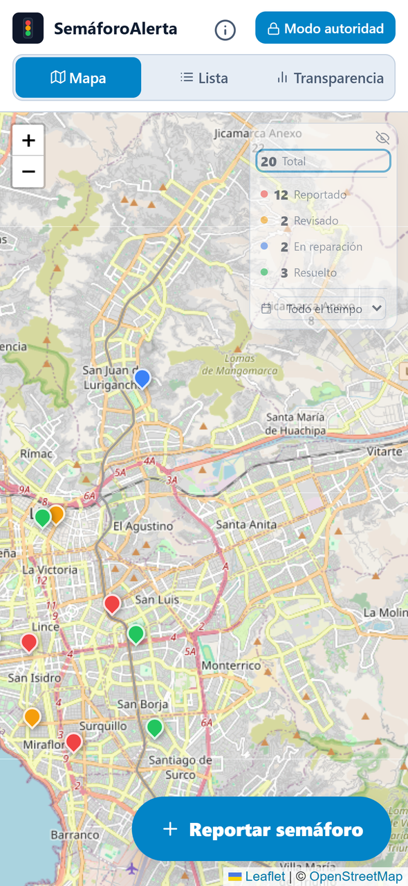
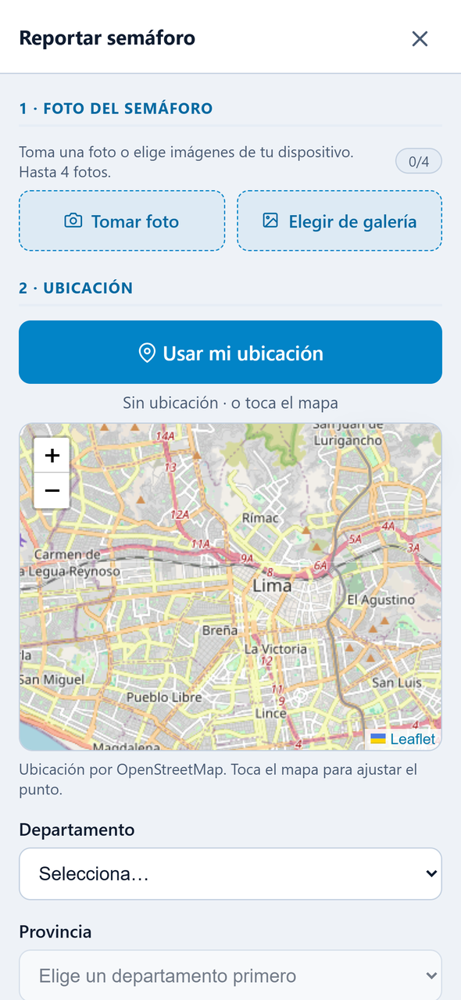
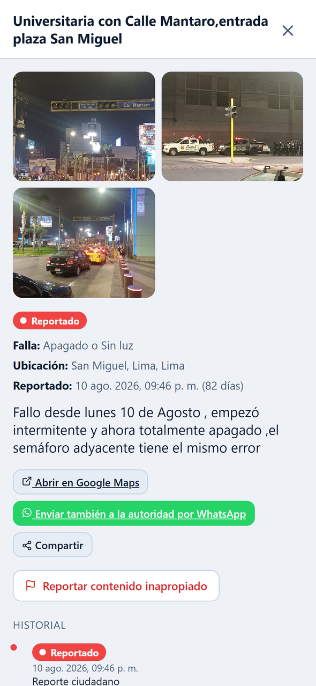
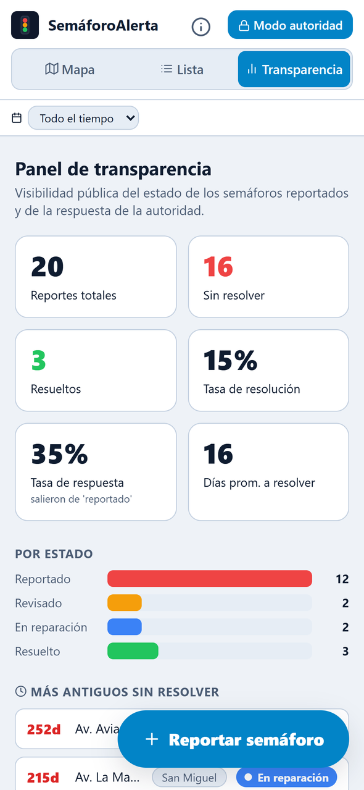
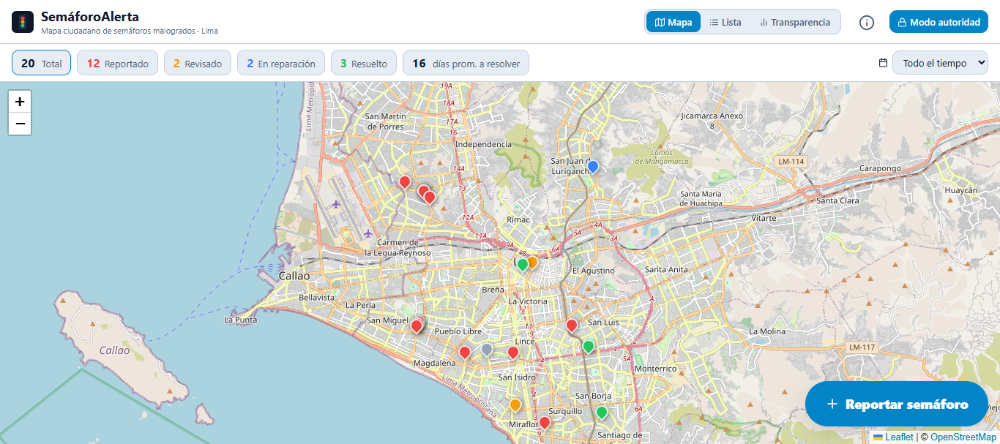

# SemáforoAlerta 🚦

Mapa público y transparente de **semáforos malogrados en el Perú** (empezando por Lima).

SemáforoAlerta permite que **cualquier persona reporte de forma completa cada
escenario en que un semáforo está malogrado**: si está apagado, solo
intermitente, pegado en un color, chocado o con los tiempos desincronizados. El
reporte incluye fotos, la ubicación exacta en el mapa, el distrito y una
descripción de lo que pasa. En el mismo momento, con un solo toque, se puede
**enviar también al WhatsApp oficial de la municipalidad**. Cada reporte queda
visible en un mapa público, y la autoridad lo va marcando como
*Revisado → En reparación → Resuelto*. La transparencia es el producto: un
backlog público y accionable que permite exigir reparaciones.

🔗 **App en vivo:** https://stoplight-incidences-tracker.vercel.app

<p align="center">
  
  
  
  
</p>

<p align="center">
  
</p>

## Por qué

Al buscar cómo reportar un semáforo malogrado en Lima solo encontré publicaciones
sueltas en Facebook con un número de teléfono o WhatsApp, sin señal de que
alguien los atendiera. Y aunque reportaras, como ciudadano no tenías forma de
saber si la autoridad vio el problema: terminabas preguntando una y otra vez,
sin saber si era lentitud o simple desidia. Este proyecto agrega lo que falta:
**visibilidad pública, historial y rendición de cuentas**, para que cualquiera
vea el estado de su reporte y cuánto tiempo lleva esperando. Y como no reemplaza
al canal oficial sino que lo complementa, el mismo reporte se puede mandar a ese
WhatsApp de la autoridad sin tener que escribirlo de nuevo.

## Qué puedes hacer

### Como ciudadano
- **Reportar un semáforo** con **+ Reportar semáforo**:
  - **Hasta 3 fotos**, tomadas con la cámara desde la app (**Tomar foto**) o
    elegidas de la galería. Las fotos se **comprimen en el navegador** (1600 px
    como máximo, JPEG al 80 %), así que el reporte se publica rápido incluso con
    datos móviles.
  - **Ubicación**: con **Usar mi ubicación** (GPS) o tocando el mapa. El
    departamento, la provincia y el distrito se completan solos mediante
    geocodificación inversa y se pueden corregir en los desplegables en cascada
    (dataset oficial UBIGEO del INEI, **todo el Perú**).
  - **Tipo de falla**: apagado o sin luz, solo intermitente, pegado en un color,
    estructura dañada o chocada, tiempos mal sincronizados u otro. Además de una
    descripción libre.
- **Enviar el reporte al WhatsApp de la municipalidad**: el botón
  **Enviar también a la autoridad por WhatsApp** abre WhatsApp con un mensaje ya
  armado (lugar, distrito, link de Google Maps, tipo de falla, descripción y link
  al reporte público). Solo hay que tocar *enviar*.
- **Compartir un reporte**: cada incidencia tiene su propio link (`?id=...`). El
  botón **Compartir** usa el menú nativo del celular (Web Share API) o copia el
  link al portapapeles.
- **Ver y filtrar**: en las vistas **Mapa**, **Lista** y **Transparencia**, filtrar
  por estado y por fecha (últimos 7, 30 o 90 días, o un rango personalizado).
- **Reportar contenido inapropiado**: la comunidad modera. Cuando un reporte
  acumula **5 denuncias se oculta automáticamente** del público.

### Como autoridad (**Modo autoridad**)
- Iniciar sesión y mover cada incidencia por su ciclo de vida:
  *Reportado → Revisado → En reparación → Resuelto* (o marcarla como *Duplicado*).
- Cada cambio queda en el **historial** público del reporte.

### Panel de transparencia
Muestra métricas públicas de la respuesta de la autoridad:
- reportes totales, sin resolver y resueltos
- tasa de resolución y tasa de respuesta
- **días promedio para resolver**
- distribución por estado
- ranking de los **reportes más antiguos sin resolver**
- comparación por distrito

Los reportes con más de 90 días sin resolver se marcan en rojo.

### Primer uso
Un popup de bienvenida explica en 4 pasos cómo reportar. La sección **Acerca de**
(ícono ⓘ) cuenta el propósito del proyecto.

## Demo local

```bash
npm install
npm run dev
```

Abre http://localhost:5173. El servidor también queda expuesto en tu red local,
para probarlo desde el celular.

Sin credenciales de Supabase, la app funciona en **modo demo**: los datos se
guardan en `localStorage` y se cargan incidencias de ejemplo en cruces reales de
Lima.

## Stack

- **React 18 + Vite** (PWA): funciona en cualquier navegador móvil, sin app store.
- **Leaflet + react-leaflet + OpenStreetMap**: mapa gratuito, sin facturación por API.
- **Nominatim (OpenStreetMap)**: geocodificación inversa de coordenadas a distrito.
- **Supabase**: Postgres + PostGIS, Auth, Storage para las fotos y políticas RLS.
- **WhatsApp click-to-chat (`wa.me`)**: envío del reporte a la autoridad sin
  depender de la API de WhatsApp Business.
- **react-icons**, **Playwright** para las pruebas e2e y **Vercel** para el despliegue.
- **Capa de datos intercambiable** (`src/data/store.js`): `localStorage` o
  Supabase sin tocar la UI.

## Arquitectura

```
src/
  constants.js            Estados, tipos de falla, rangos de fecha, centro de Lima
  shareLink.js            Links compartibles por reporte (?id=) con la History API
  useBackClose.js         Cierra modales con el botón "atrás" del celular
  App.jsx                 Layout, vistas, filtros, estadísticas, modo autoridad
  data/
    store.js              Selector de backend (Supabase o localStorage)
    localStore.js         Backend demo en localStorage
    supabaseStore.js      Backend Supabase (consultas, subida de fotos, flag_incident)
    supabaseClient.js     Cliente y detección de credenciales
    auth.js               Sesión y rol "reviewer" (Supabase Auth)
    helpers.js            Distancia Haversine, estadísticas, métricas del panel
    whatsapp.js           Arma el mensaje y el link wa.me hacia la autoridad
    geo.js                Geocodificación inversa con Nominatim
    peru.js               Departamento → Provincia → Distrito (UBIGEO)
    peru-ubigeo.json      Dataset UBIGEO (INEI)
    seed.js               Incidencias de ejemplo
  components/
    MapView.jsx           Mapa principal con pines por estado
    IncidentList.jsx      Vista de lista
    DashboardView.jsx     Panel de transparencia
    ReportForm.jsx        Formulario: cámara/galería, compresión, GPS, mini-mapa
    IncidentDetail.jsx    Detalle, historial, WhatsApp, Compartir, denuncia y acciones de autoridad
    OnboardingModal.jsx   Bienvenida de primer uso
    AboutView.jsx / AboutModal.jsx
    AuthModal.jsx         Login del modo autoridad
    StatusBadge.jsx
supabase/
  schema.sql              Esquema completo (tablas, PostGIS, triggers, RLS, bucket, flag_incident)
  seed.sql                Datos de ejemplo para Supabase
tests/e2e/smoke.spec.js   Prueba de humo (escritorio + iPhone)
```

### Flujo del envío por WhatsApp
WhatsApp no permite enviar mensajes automáticamente sin su API de empresas, así
que `src/data/whatsapp.js` arma un link de *click to chat*
(`https://wa.me/<número>?text=...`) con el mensaje prellenado. El número del
canal oficial está en `AUTHORITY_WHATSAPP_NUMBER`. El mensaje incluye el link
público del reporte (`buildIncidentUrl`), para que la autoridad vea las fotos y
el historial.

### Moderación comunitaria
La función `flag_incident(uuid)` de `schema.sql` (`security definer`, expuesta
a `anon`) suma una denuncia y pone `hidden = true` al llegar a 5. Las políticas
de lectura solo devuelven las incidencias con `not hidden`. El backend demo
replica la misma regla.

## Conectar Supabase (ya está cableado)

La capa de datos elige el backend automáticamente: **si hay credenciales de
Supabase en `.env`, usa Supabase; si no, usa `localStorage` (demo)**. La UI no
cambia.

Para activar Supabase:

1. Crea un proyecto en [supabase.com](https://supabase.com) (región US, más cerca de Perú).
2. En **SQL Editor**, pega y ejecuta [`supabase/schema.sql`](supabase/schema.sql).
   Crea las tablas, PostGIS, el historial automático, RLS, la moderación y el
   bucket de fotos.
3. En **Project Settings → API**, copia el **Project URL** y la **anon public key**.
4. Pégalas en `.env` (basado en `.env.example`):
   ```
   VITE_SUPABASE_URL=https://tu-proyecto.supabase.co
   VITE_SUPABASE_ANON_KEY=tu-anon-public-key
   ```
5. Reinicia `npm run dev`.

### Archivos clave
- `src/data/store.js`: selecciona el backend y expone la interfaz async.
- `src/data/localStore.js`: backend localStorage (demo).
- `src/data/supabaseStore.js`: backend Supabase (consultas + subida de fotos a Storage).
- `src/data/supabaseClient.js`: crea el cliente y detecta si está configurado.
- `supabase/schema.sql`: esquema completo para pegar en Supabase.

### Seguridad de "modo autoridad"
`schema.sql` aplica por defecto las políticas RLS **seguras (Fase 2)**: solo
pueden cambiar estados los usuarios autenticados con rol `reviewer`. Ese rol lo
asigna en `app_metadata` un admin con la `service_role` y nadie se lo puede
auto-asignar. La creación de reportes, la lectura del mapa y la denuncia de
contenido siguen siendo públicas. La **Fase 1** (cualquiera actualiza; ⚠ es
insegura y solo sirve para pruebas iniciales) queda comentada en el archivo como
rollback.

Para crear un revisor, en Supabase entra a **Authentication → Users → Add user**
y luego asígnale el rol con la `service_role` key:
`app_metadata: { "role": "reviewer" }`.

## Pruebas

```bash
npm run test:e2e      # Playwright en Chromium de escritorio y en iPhone 13
npm run test:e2e:ui   # modo interactivo
```

Las pruebas corren en modo demo (`--mode test` carga `.env.test`), así que no
necesitan credenciales de Supabase.

## Ideas siguientes

- Detección de duplicados con `ST_DWithin` (ya esbozada con Haversine en el demo).
- Notificaciones cuando cambia el estado de un reporte que sigues.
- Compatibilidad con el estándar **Open311** para interoperar con sistemas oficiales.
- Service worker para uso offline real (PWA instalable).
- Envío automático a la autoridad vía WhatsApp Business API, con confirmación de recepción.
